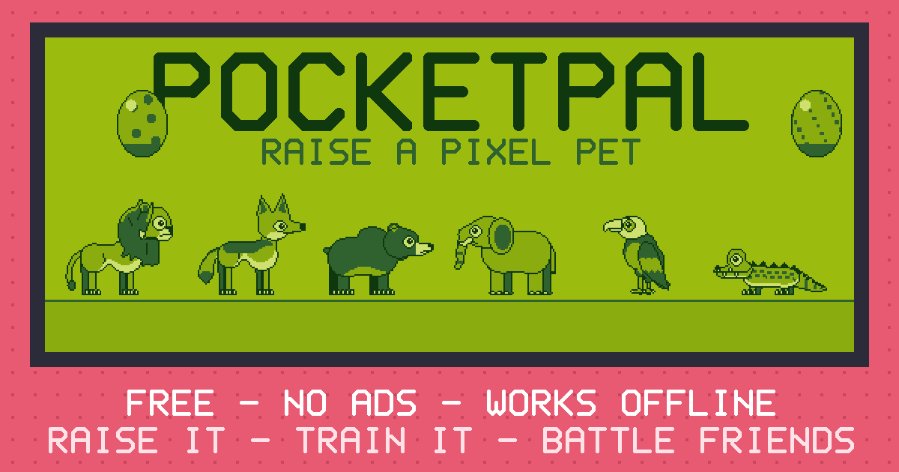

# PocketPal 🥚

A little pixel pet that lives in a handheld (it starts in Midnight, and you can repaint it in lots of colours), like the 90s Tamagotchi toys. Hatch an egg, look after your pal and watch it grow up.

**[▶ Play PocketPal](https://0mrcrazy0.github.io/pocketpal/)**

This is **version 2.6.5**. It's free, with no ads and no accounts, and it works offline.

## Put it on your phone

Open the play link, then:

- **iPhone or iPad (Safari):** tap **Share**, then **Add to Home Screen**.
- **Android (Chrome):** tap the **⋮** menu, then **Install app** or **Add to Home screen**.

PocketPal then opens from its own icon, just like an app.

## Buttons

| Button | What it does | Keyboard |
|---|---|---|
| **A** | Move to the next icon | `A` or the arrow keys |
| **B** | Choose | `Enter` or `Space` |
| **C** | Go back | `Esc` |

You can also tap the screen. **MENU** opens the main menu, and **♪** turns the sound on or off.

## Looking after your pal

- **Feed it** when it's hungry. Meals are best; too many snacks aren't good for it.
- **Clean up** poop, and give **medicine** if it gets sick.
- **Turn the lights off** at bedtime.
- When a **!** flashes, your pal needs you. Try to answer within about 30 minutes.
- Good care grows a stronger adult. **Status** shows how your pal is doing.

Don't worry: a night's sleep or a day at school won't hurt your pal.

## Battles and friends

- Pals can **battle**, train and win cups.
- Share your **battle code** (or its QR code) with a friend so your pals can battle, swap gifts and visit each other.
- **Live battles** let you and a friend pick moves together using a 4-letter room code.

## Each pal is its own game

Every pal has its own coins, items and progress. A new egg starts fresh, and your other pals keep everything they had.

Switching phones or clearing the browser? Make a backup first in **Settings ▸ Backup**.

## Share the game

Send your friends the play link: **https://0mrcrazy0.github.io/pocketpal/**. In the game, go to **MENU ▸ About ▸ Share the game**. When you paste the link into a chat, this picture shows up:

## Safe and private

There are no ads, no tracking and no accounts. Your pal stays on your device unless you choose to use online extras, and the public friends board stays off until a grown-up turns it on.

---

Grown-ups and developers: the full player guide is in [DESIGN.md](DESIGN.md#full-player-guide-moved-from-readme-in-265), the care rules are in [CARE.md](CARE.md), and hosting and tests are in [DEPLOY.md](DEPLOY.md). Made with ❤️. MIT licence (see `LICENSE`).
